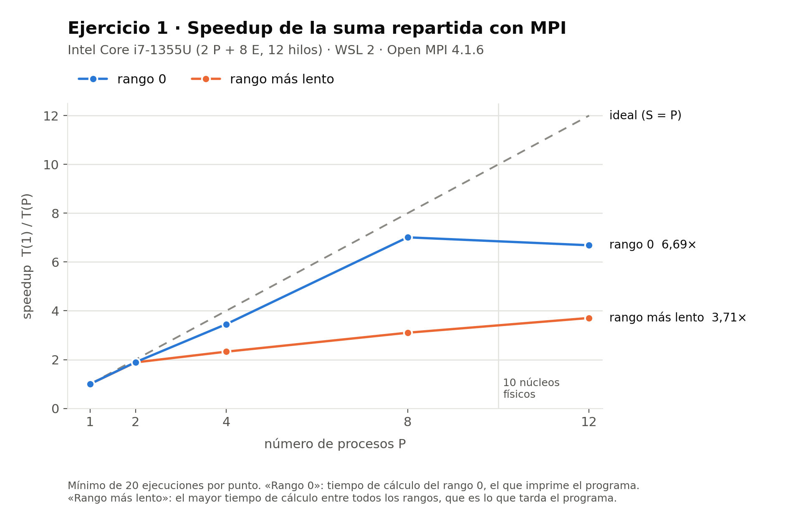

# Práctica 4 · Ejercicio 1

## Todos ejecutan lo mismo, y cada uno hace su parte

[`p4_ej1.c`](../src/ejercicio1/p4_ej1.c) reparte la suma de 200 millones de
raíces `sqrt(i + 0.5)` entre los procesos con el reparto por rango del apartado
4.1.9: los primeros `N % P` rangos se llevan un sumando más. Nuestra parte es la
**recogida**: cada rango manda su parcial al rango 0 y el rango 0 los suma
(apartado 4.2.1).

> Las cifras de este documento son de la ejecución del 15/11/2026 que está en
> `resultados/ejercicio1/`. Si se relanza el script, hay que actualizarlas con
> la nueva `tabla_ej1.md`.

## 1. La recogida

```c
/* Cada rango manda en UN solo mensaje su suma parcial y su tiempo: dos
   double cuestan lo mismo que uno (4.2.5) y el rango 0 puede saber
   cuanto tardo el mas lento, que es lo que tarda el programa (4.5.2). */
double parcial[2] = { mio, t };

if (yo != 0) {
    MPI_Send(parcial, 2, MPI_DOUBLE, 0, ET_PARCIAL, MPI_COMM_WORLD);
} else {
    double total = mio;            /* el 0 empieza con lo suyo... */
    double t_max = t;
    int rango_lento = 0;
    double recibido[2];
    /* ...y recibe de los demas en orden fijo de rango: la suma sale
       siempre en el mismo orden y es reproducible bit a bit (4.2.3). */
    for (int origen = 1; origen < cuantos; origen++) {
        MPI_Recv(recibido, 2, MPI_DOUBLE, origen, ET_PARCIAL,
                 MPI_COMM_WORLD, MPI_STATUS_IGNORE);
        total += recibido[0];
        if (recibido[1] > t_max) {
            t_max = recibido[1];
            rango_lento = origen;
        }
    }
    printf("suma con %d procesos = %e  el rango 0 tardo %.4f s\n",
           cuantos, total, t);
    printf("  suma completa = %.15e  el mas lento fue el rango %d: %.4f s\n",
           total, rango_lento, t_max);
}
```

- **El rango 0 no se manda nada a sí mismo**: empieza con su `mio` y hace un bucle
  de `cuantos - 1` recepciones, como dice la pista.
- **Origen explícito, no `MPI_ANY_SOURCE`**: el 0 suma los parciales siempre en el
  mismo orden (1, 2, 3...), así que con un mismo `P` el total es idéntico bit a
  bit en todas las ejecuciones. Con el comodín el orden de llegada cambiaría y,
  como la suma en coma flotante no es asociativa, también los últimos dígitos.
- **Etiqueta con nombre** (`ET_PARCIAL`), como recomienda el apartado 4.2.3.
- **Un solo mensaje con dos `double`**: además del parcial, cada rango manda su
  tiempo. Mandar 16 bytes cuesta lo mismo que mandar 8 (lo que se paga es la
  latencia de la llamada, 4.2.5), y así el rango 0 sabe cuánto tardó el rango
  más lento. La primera línea que se imprime es exactamente la del enunciado.
- **Segunda línea con la suma completa** (`%.15e`): con `%e` solo salen 7 cifras,
  y un reparto que se dejara sumandos imprimiría lo mismo (ver el punto 5).

### Revisión de la primera versión

La recogida de la primera versión ya era correcta (mismo patrón que `rangos.c`
del apartado 4.1.9) y compilaba sin avisos. Cambios hechos:

| Cambio | Por qué |
|---|---|
| `p4-ej1.c` → `p4_ej1.c` | Es el nombre del enunciado y el que usa la orden de compilación del propio fichero. |
| Etiqueta `1` → `ET_PARCIAL` | Constantes con nombre (4.2.3); el código cuenta un 15 % de la nota. |
| Se manda `{parcial, tiempo}` | El tiempo de un programa paralelo es el del rango más lento (4.5.2); publicar solo el del rango 0 es justo el error del ejercicio 4 de los apuntes. |
| Suma también con `%.15e` | Para poder comprobar de verdad que el total no cambia con `P`. |
| Salto de línea al final del fichero | Faltaba. |

## 2. Cómo se ejecuta

Todo sale de una orden, desde la raíz del repositorio en WSL:

```console
bash PracticaT4/src/ejercicio1/ejecutar_ej1.sh        # 20 repeticiones por defecto
```

Compila, lanza tres veces con 4 procesos, mide con 1, 2, 4, 8 y 12 procesos,
comprueba la suma con 3, 7 y 12 procesos (repartos no exactos) y genera la tabla
y la gráfica. En `resultados/ejercicio1/` solo deja los cuatro ficheros del
punto 8; la compilación y las comprobaciones salen por pantalla. A mano:

```console
mpicc -O2 -Wall -Wextra -o bin/p4_ej1 src/ejercicio1/p4_ej1.c -lm
mpirun --use-hwthread-cpus -np 4 bin/p4_ej1
```

**Por qué `--use-hwthread-cpus`**: WSL 2 presenta el i7-1355U como 6 núcleos con
2 hilos, y Open MPI da por defecto un hueco por núcleo, así que `-np 8` y `-np 12`
fallan con *There are not enough slots available*. Con esa opción cuenta los 12
hilos. En WSL los procesos no quedan fijados a ningún núcleo (`--report-bindings`
dice *not bound*): es el planificador de Windows quien decide dónde corre cada uno.

## 3. Entorno

| | |
|---|---|
| Procesador | Intel Core i7-1355U: 10 núcleos físicos (2 de rendimiento con 2 hilos + 8 de eficiencia) y 12 hilos |
| Sistema | Windows 11 + WSL 2, Ubuntu 24.04.4 LTS (núcleo 6.6.87.2-microsoft-standard-WSL2) |
| Compilador | gcc 13.3.0, `-O2 -Wall -Wextra` (sin ningún aviso) |
| MPI | Open MPI 4.1.6 (implementa MPI 3.1) |

## 4. La salida desordenada

Tres ejecuciones seguidas con 4 procesos (`resultados/ejercicio1/orden_4procesos.txt`;
para la **captura** que pide el PDF hay que lanzarlo en la terminal):

```text
$ mpirun --use-hwthread-cpus -np 4 bin/p4_ej1        # ejecucion 1 de 3
hola, soy el rango 0 de 4
hola, soy el rango 1 de 4
hola, soy el rango 2 de 4
hola, soy el rango 3 de 4
suma con 4 procesos = 1.885618e+12  el rango 0 tardo 0.1087 s
  suma completa = 1.885618083164316e+12  el mas lento fue el rango 3: 0.1183 s

$ mpirun --use-hwthread-cpus -np 4 bin/p4_ej1        # ejecucion 2 de 3
hola, soy el rango 2 de 4
hola, soy el rango 0 de 4
hola, soy el rango 1 de 4
hola, soy el rango 3 de 4
suma con 4 procesos = 1.885618e+12  el rango 0 tardo 0.0884 s
  suma completa = 1.885618083164316e+12  el mas lento fue el rango 3: 0.1085 s

$ mpirun --use-hwthread-cpus -np 4 bin/p4_ej1        # ejecucion 3 de 3
hola, soy el rango 2 de 4
hola, soy el rango 3 de 4
hola, soy el rango 0 de 4
hola, soy el rango 1 de 4
suma con 4 procesos = 1.885618e+12  el rango 0 tardo 0.1147 s
  suma completa = 1.885618083164316e+12  el mas lento fue el rango 0: 0.1147 s
```

Tres órdenes distintos: 0‑1‑2‑3, 2‑0‑1‑3 y 2‑3‑0‑1. **Explicación** (4.1.4 y 4.1.8):

1. **Los cuatro procesos son independientes.** Es SPMD: cuatro copias del mismo
   binario que salen de `MPI_Init` casi a la vez y compiten por llegar al
   `printf`. Nada en el programa dice que el 0 vaya antes que el 3; el que el
   sistema operativo ponga antes a correr, escribe antes. En este portátil,
   además, los núcleos no son iguales (rendimiento y eficiencia), y en WSL el
   planificador de Windows reparte los procesos como quiere.
2. **Las cuatro salidas pasan por el lanzador.** Cada proceso escribe en su propia
   `stdout`, que es una tubería hacia `mpirun`; `mpirun` va volcando en la
   terminal lo que le llega, en el orden en que le llega. El `fflush(stdout)`
   hace que cada línea salga entera en cuanto se escribe.
3. **Las dos líneas de la suma salen siempre al final, y eso no es casualidad**:
   el rango 0 solo puede imprimirlas después de recibir los parciales, y cada
   rango manda el suyo después de su `printf`. Ese «después» lo imponen los
   mensajes: es el único orden que existe entre procesos (4.1.8: *no hay un
   «después» compartido salvo que tú lo escribas*).

No es un error: MPI no ordena la salida. Si hiciera falta, se haría que solo
imprima el rango 0, o que los demás le manden sus líneas.

## 5. La suma no cambia con el número de procesos

`N = 200 000 000` es múltiplo de 1, 2, 4 y 8, pero no de 12 (`N % 12 = 8`). Para
probar más repartos no exactos se añaden 3 y 7 procesos (paso 4 del script, que
lo muestra por pantalla):

| P | N % P | Suma completa | Diferencia relativa con P = 1 |
|---:|---:|---|---:|
| 1 | 0 | 1,885618083164028·10¹² | — |
| 2 | 0 | 1,885618083163375·10¹² | 3,5·10⁻¹³ |
| 3 | 2 | 1,885618083164141·10¹² | 6,0·10⁻¹⁴ |
| 4 | 0 | 1,885618083164316·10¹² | 1,5·10⁻¹³ |
| 7 | 4 | 1,885618083164254·10¹² | 1,2·10⁻¹³ |
| 8 | 0 | 1,885618083164125·10¹² | 5,1·10⁻¹⁴ |
| 12 | 8 | 1,885618083164184·10¹² | 8,3·10⁻¹⁴ |

- Con cada `P`, las 20 ejecuciones dan **exactamente** la misma suma (recogida en
  orden fijo).
- Entre distintos `P` solo cambian las cifras 13.ª a 16.ª: cada rango suma su
  trozo y luego se suman los parciales, y la suma en coma flotante no es
  asociativa. Un reparto que no repartiera el resto perdería los sumandos del
  final, que valen ≈ √(2·10⁸) ≈ 14 142 cada uno: ~7·10⁻⁹ de diferencia relativa
  **por sumando**, cinco órdenes de magnitud por encima de lo observado.
- Comprobación independiente: Σ√(i + 0,5) es la regla del punto medio de
  ∫₀ᴺ √x dx = ⅔·N^(3/2) = 1,885618083164·10¹², que coincide con la suma
  calculada en sus 13 primeras cifras.

## 6. Tiempos y speedup

Tiempo de la función `trozo` medido con `MPI_Wtime` dentro del programa. **20
ejecuciones por configuración**, alternando 1, 2, 4, 8 y 12 procesos en cada
ronda; la tabla da el **mínimo** (trampa 3) y, entre paréntesis, la mediana.
Datos completos en `resultados/ejercicio1/tiempos.csv`.

| Procesos | T rango 0 (s) | T más lento (s) | Speedup rango 0 | Eficiencia | Speedup más lento | Eficiencia |
|---:|---:|---:|---:|---:|---:|---:|
| 1 | 0,2454 (0,2529) | 0,2454 (0,2529) | 1,00 | 100,0 % | 1,00 | 100,0 % |
| 2 | 0,1296 (0,1327) | 0,1301 (0,1347) | 1,89 | 94,7 % | 1,89 | 94,3 % |
| 4 | 0,0711 (0,0993) | 0,1055 (0,1162) | 3,45 | 86,3 % | 2,33 | 58,2 % |
| 8 | 0,0350 (0,0764) | 0,0791 (0,0825) | 7,01 | 87,6 % | 3,10 | 38,8 % |
| 12 | 0,0367 (0,0578) | 0,0662 (0,0765) | 6,69 | 55,7 % | 3,71 | 30,9 % |

Speedup = T(1) / T(P) con los mínimos; eficiencia = speedup / P. La referencia es
la ejecución con 1 proceso, que no tiene a nadie esperando (la trampa 2 no aplica).



- **Rango 0**: el tiempo que imprime el programa, como pide el enunciado.
- **Rango más lento**: el mayor tiempo de cálculo entre todos los rangos. Como el
  rango 0 se queda esperando en `MPI_Recv` hasta que llega el último parcial, el
  programa tarda lo que tarda el más lento (apartado 4.5.2).

## 7. Conclusiones (borrador)

**1. El reparto escala bien porque es cálculo puro con una comunicación mínima.**
Cada rango calcula su trozo sin hablar con nadie y al final manda un único
mensaje de 16 bytes: en total `P − 1` mensajes, que cuestan del orden de
microsegundos (4.2.5), frente a décimas de segundo de cálculo. La relación
cálculo/comunicación es enorme, y por eso con 2 procesos el speedup es 1,89
(94 % de eficiencia). Es el mejor caso posible para MPI, la referencia contra la
que comparar el ejercicio 5.

**2. Lo que frena el speedup no es MPI, es la máquina.** Con más procesos la
eficiencia cae (3,10× con 8 y 3,71× con 12, mirando el más lento), igual que en
los apuntes (4,00× con 8 procesos en 4.1.9) y en la figura P4.1 del guion (en
torno a 4× con 8 procesos en Linux). Causas:

- **Núcleos de dos clases.** Con 1 proceso el tiempo es bimodal: 15 de 20
  ejecuciones tardan 0,245–0,29 s y 5 tardan 0,32–0,34 s, un 30 % más, lo que
  encaja con caer en un núcleo de rendimiento (hasta 5,0 GHz) o en uno de
  eficiencia (hasta 3,7 GHz). El reparto es estático y a partes iguales, así que
  el programa va al ritmo del rango que caiga en el núcleo más lento.
- **Turbo y límite de potencia.** La referencia con 1 proceso corre a la
  frecuencia máxima de un solo núcleo; con muchos núcleos activos, un
  procesador de portátil de 15 W baja la frecuencia. Con 8 procesos el rango más
  lento procesa unos 316 millones de sumandos/s, frente a 815 millones/s del
  proceso solo: mucho menos que la diferencia entre los dos tipos de núcleo.
  (Es una explicación razonada: desde WSL no se puede leer la frecuencia real.)
- **Más allá de 10 procesos no hay más núcleos físicos.** Con 12 procesos en 12
  hilos, por fuerza hay procesos compartiendo un núcleo de rendimiento con su
  otro hilo, y se reparten sus unidades de cálculo. Aun así se gana algo
  (3,10 → 3,71).

**3. El tiempo del rango 0 engaña.** Con 8 procesos el mejor tiempo del rango 0
da un speedup de 7,01, pero el del más lento da 3,10; con 12, 6,69 frente a 3,71.
El rango 0 es solo uno de los P procesos y a veces cae en un núcleo rápido; el
programa no termina hasta que acaba el último. Por eso p4_ej1.c recoge también el
tiempo de cada rango.

**4. Qué pasaría si el reparto no tuviera en cuenta el resto** (cálculo que
`grafica_ej1.py` muestra por pantalla al final del script):

- *Si todos se llevan `N / P` y nadie coge los que sobran*, se pierden los
  `N % P` últimos sumandos, que además son los más grandes. Con 12 procesos se
  pierden 8 sumandos que valen 113 137,1: la suma pasa a
  1,885617970026944·10¹² (error relativo 6·10⁻⁸)… y con `%e` se imprime
  **1.885618e+12, igual que la correcta**. El fallo sería silencioso; por eso hay
  que comprobar con todas las cifras.
- *Si el último se queda con todo el resto*, no se pierde nada pero se
  desequilibra la carga: el último hace `N/P + N%P`. Aquí da igual (8 sumandos
  más sobre 16 666 666), pero con pocos sumandos por proceso es grave: con
  N = 100 y P = 24, el último hace 8 y los demás 4, es decir 1,92 veces la media,
  y todos le esperan. Con la fórmula del enunciado la diferencia entre el que más
  hace y el que menos es siempre 1 sumando.

## 8. Ficheros generados

En `resultados/ejercicio1/`, uno por cada cosa que pide el enunciado más los
datos de los que salen la tabla y la gráfica:

| Fichero | Contenido | Para qué |
|---|---|---|
| `orden_4procesos.txt` | las tres ejecuciones con 4 procesos | salida y explicación del orden (punto 4) |
| `tabla_ej1.md` | mínimo, mediana, speedup y eficiencia | tabla de tiempos (punto 6) |
| `grafica_speedup.png` | speedup frente a procesos con la diagonal ideal | gráfica (punto 6) |
| `tiempos.csv` | las 100 ejecuciones medidas | datos en bruto; `grafica_ej1.py` los necesita para rehacer tabla y gráfica |
