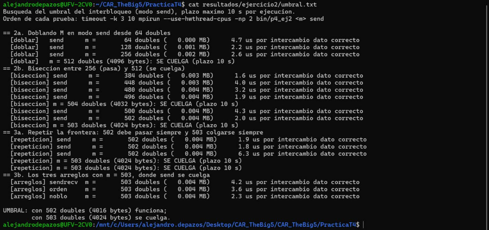
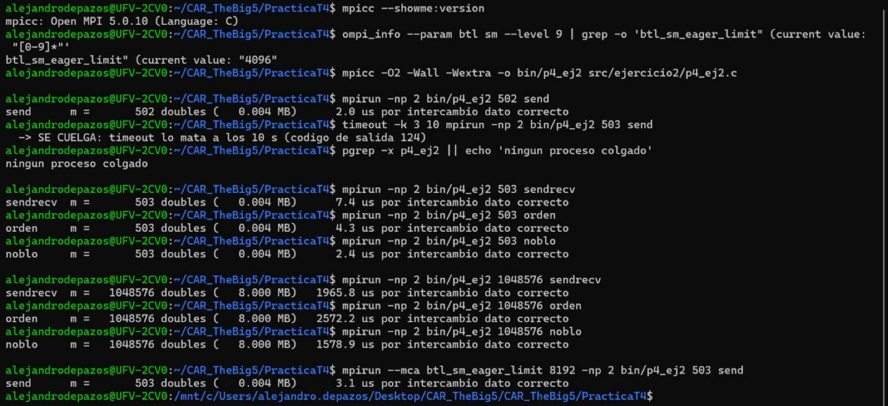
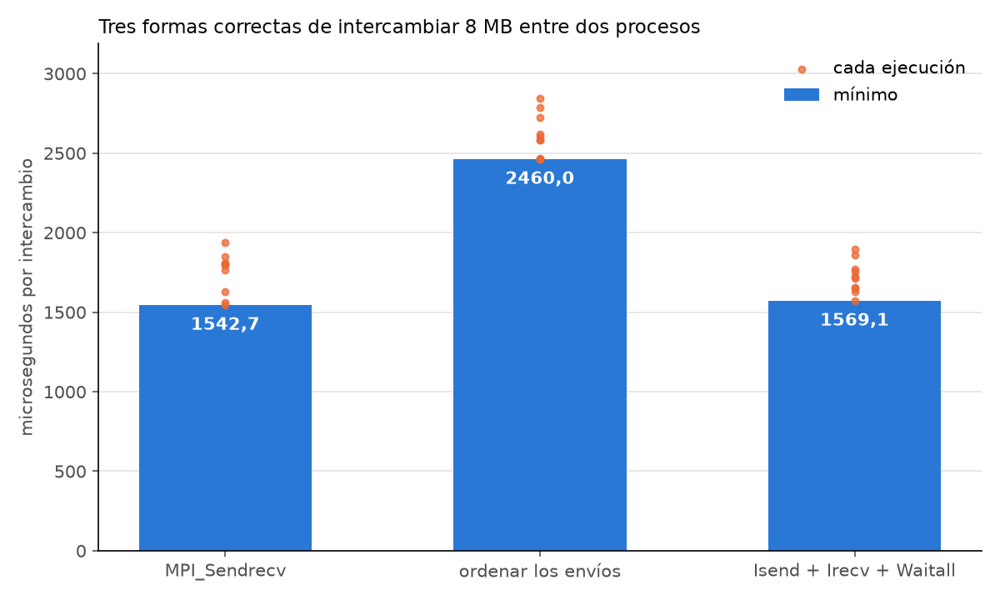

# Práctica 4 · Ejercicio 2

## El interbloqueo, y el número exacto en el que aparece

[`p4_ej2.c`](../src/ejercicio2/p4_ej2.c) intercambia un mensaje de `M` double
entre dos procesos, 20 veces seguidas, y mide cuánto tarda cada intercambio. En
el modo `send` los dos procesos mandan primero y reciben después: es el
interbloqueo clásico del apartado 4.2.6, que **con mensajes pequeños funciona**.
Hay que encontrar el tamaño exacto a partir del cual se cuelga, explicar por qué
funciona por debajo, escribir el arreglo con `MPI_Sendrecv` y compararlo con los
otros dos (ordenar los envíos e `Isend`/`Irecv`) con un millón de double.

> Las cifras de este documento son de la ejecución del 16/11/2026 que está en
> `resultados/ejercicio2/`. Si se relanza el script, hay que actualizarlas con
> la nueva `tabla_ej2.md`.

**Resultado en una línea:** con Open MPI 5.0.10 el programa funciona con 502
double (4 016 bytes) y se cuelga con 503 (4 024 bytes), justo por debajo del
límite de 4 096 bytes con el que Open MPI deja de copiar los mensajes. Con 8 MB,
`MPI_Sendrecv` e `Isend`/`Irecv` empatan (~1 550 µs) y ordenar los envíos es
1,59 veces más lento.

## 1. Nuestra parte: `con_sendrecv`

```c
/* Arreglo 1: una sola llamada que manda y recibe a la vez.
   EJERCICIO 2: escribela con MPI_Sendrecv (apartado 4.2.6). */
static void con_sendrecv(long m, int yo, int otro)
{
    (void)yo;   /* los dos rangos hacen exactamente lo mismo: no hace falta */
    /* Primero los cinco argumentos del envio y despues los cinco de la
       recepcion. El destino y el origen son el mismo proceso, 'otro', y las
       dos etiquetas valen 0 porque el otro rango tambien manda con la 0: si
       no coincidieran, el mensaje no se emparejaria y se quedaria esperando.
       Cada sentido tiene su propio buffer: no se puede recibir encima de lo
       que se esta mandando (para eso existe MPI_Sendrecv_replace).
       MPI hace avanzar el envio y la recepcion a la vez, asi que nunca se
       queda bloqueado esperando a que el otro reciba (apartado 4.2.6). */
    MPI_Sendrecv(envio,  m, MPI_DOUBLE, otro, 0,
                 recibo, m, MPI_DOUBLE, otro, 0,
                 MPI_COMM_WORLD, MPI_STATUS_IGNORE);
}
```

- **Diez argumentos más el comunicador y el estado**: los cinco de un
  `MPI_Send` (búfer, cuenta, tipo, destino, etiqueta) seguidos de los cinco de un
  `MPI_Recv` (búfer, cuenta, tipo, origen, etiqueta), con un solo comunicador.
- **Destino y origen son el mismo proceso**, `otro`, como dice la pista: cada
  rango manda al otro y recibe del otro. En un anillo serían distintos (mandar al
  de la derecha y recibir del de la izquierda), y la misma llamada valdría.
- **Etiquetas iguales en los dos lados.** Mi recepción con etiqueta 0 tiene que
  emparejarse con el envío del otro rango, que también usa la 0 (regla del
  emparejamiento del apartado 4.2.1). Con etiquetas mal puestas no hay error de
  compilación: el programa se queda esperando.
- **Dos búferes distintos.** Se manda `envio` y se recibe en `recibo`; recibir
  encima del búfer que se está mandando no está permitido.
- **No necesita `yo`**: los dos rangos ejecutan la misma llamada, sin `if`. Ese
  es su atractivo frente a ordenar los envíos.
- **Por qué no se cuelga**: la llamada es una sola, y la implementación hace
  progresar el envío y la recepción a la vez. Ningún proceso se queda dentro de
  un envío esperando a que el otro llegue a su recepción, que es justo lo que
  produce el interbloqueo. Lo comprobamos justo en el tamaño que cuelga a `send`
  (503 double) y con 8 MB.
- **Es correcto, no solo «no se cuelga»**: imprime `dato correcto` en todas las
  ejecuciones (cada rango rellena su búfer con `yo + 1`, así que el rango 0 debe
  recibir doses). El script se para si algún arreglo imprime `DATO MAL`.
- **Compila sin ningún aviso** con `-O2 -Wall -Wextra`.

## 2. Cómo se ejecuta

Todo sale de una orden, desde la raíz del repositorio en WSL:

```console
bash PracticaT4/src/ejercicio2/ejecutar_ej2.sh          # 10 rondas, plazo de 10 s
bash PracticaT4/src/ejercicio2/ejecutar_ej2.sh 20 5     # 20 rondas, plazo de 5 s
```

Tarda unos tres minutos, porque cada ejecución que se cuelga consume el plazo
entero. Hace lo siguiente:

1. Compila `p4_ej2.c` con `-O2 -Wall -Wextra`.
2. **Busca el umbral en modo `send`**: dobla `M` desde 64 double hasta que se
   cuelga y después afina por bisección entre el último tamaño que pasa y el
   primero que se cuelga, hasta el double exacto.
3. Repite la frontera (el último que pasa tres veces, el primero que se cuelga
   dos) para comprobar que el umbral es estable, y lanza los tres arreglos justo
   en el tamaño que cuelga a `send`, para comprobar que ninguno se cuelga ahí.
4. Mide los tres arreglos con 1 048 576 double (8 MB), 10 rondas, rotando el
   orden de los tres en cada ronda para que ninguno salga siempre el primero.
5. Genera las tablas y la gráfica.

**Trampa 1, el plazo máximo.** Cada ejecución se lanza así:

```console
timeout -k 3 10 mpirun --use-hwthread-cpus -np 2 bin/p4_ej2 <M> send
```

Open MPI no tiene la opción `-timeout` de Microsoft MPI, así que se usa
`timeout`: a los 10 s manda la señal de terminar a `mpirun`, y si a los 3 s
siguientes sigue vivo, lo mata (`-k 3`). Una ejecución colgada devuelve el
código 124. Después el script comprueba con `pgrep -x p4_ej2` que no ha quedado
ningún proceso colgado y, si queda alguno, lo mata con `pkill`. En toda la
búsqueda no quedó ninguno. Diez segundos sobran: un intercambio que funciona
tarda unos microsegundos, así que los 20 intercambios terminan en mucho menos
de un segundo.

**Las capturas** salen de `captura_ej2.bat` y `captura_barrido.bat` (en
`src/ejercicio2/`, se lanzan con doble clic desde Windows): abren WSL en
`PracticaT4`, escriben cada orden detrás del prompt y la ejecutan.

## 3. Entorno

| | |
|---|---|
| Procesador | Intel Core Ultra 5 225U: 12 núcleos (2 de rendimiento, 8 de eficiencia y 2 de bajo consumo) y 14 hilos; WSL lo presenta como 7 núcleos con 2 hilos |
| Sistema | Windows 11 + WSL 2, Ubuntu 26.04.1 LTS (núcleo 6.18.58.1-microsoft-standard-WSL2) |
| Compilador | gcc 15.2.0, `-O2 -Wall -Wextra` (sin ningún aviso) |
| MPI | Open MPI 5.0.10 (implementa MPI 3.1) |

**Ojo: no es el mismo portátil que el del ejercicio 1** (i7-1355U, Ubuntu 24.04,
Open MPI 4.1.6). Los dos procesos están en la misma máquina, así que los mensajes
viajan por memoria compartida (el componente `sm` de Open MPI), no por una red.

## 4. El barrido hasta el umbral

Plazo máximo: 10 s por ejecución. Orden exacta de cada prueba:
`timeout -k 3 10 mpirun --use-hwthread-cpus -np 2 bin/p4_ej2 <M> send`. Cada
línea queda en `resultados/ejercicio2/umbral.txt`:



| Fase | M (doubles) | Bytes | Resultado | µs por intercambio |
|---|---:|---:|---|---:|
| doblando | 64 | 512 | funciona | 4,7 |
| doblando | 128 | 1 024 | funciona | 2,2 |
| doblando | 256 | 2 048 | funciona | 2,6 |
| doblando | 512 | 4 096 | **se cuelga** | — |
| bisección | 384 | 3 072 | funciona | 1,6 |
| bisección | 448 | 3 584 | funciona | 4,0 |
| bisección | 480 | 3 840 | funciona | 3,2 |
| bisección | 496 | 3 968 | funciona | 1,9 |
| bisección | 504 | 4 032 | **se cuelga** | — |
| bisección | 500 | 4 000 | funciona | 4,3 |
| bisección | 502 | 4 016 | funciona | 2,0 |
| bisección | 503 | 4 024 | **se cuelga** | — |
| repetición | 502 (×3) | 4 016 | funciona las 3 veces | 1,9 / 1,8 / 6,3 |
| repetición | 503 (×2) | 4 024 | **se cuelga las 2 veces** | — |
| los tres arreglos | 503 | 4 024 | `sendrecv`, `orden` y `noblo` funcionan | 4,2 / 3,6 / 2,3 |

**Umbral: funciona con 502 double (4 016 bytes) y se cuelga con 503 double
(4 024 bytes).** Es estable: la frontera se repitió y dio siempre lo mismo.

**De dónde sale el número.** Open MPI dice cuál es su límite para los mensajes que
copia por memoria compartida:

```console
$ ompi_info --param btl sm --level 9 | grep eager_limit
... parameter "btl_sm_eager_limit" (current value: "4096", ...)
    Size (in bytes, including header) ...
```

Son **4 096 bytes contando la cabecera** que Open MPI añade a cada mensaje. 502
double son 4 016 bytes de datos y caben con la cabecera; 503 son 4 024 y ya no.
Así que la cabecera ocupa entre 73 y 80 bytes, y el umbral exacto es «4 096
menos la cabecera».

**La prueba de que lo decide ese búfer.** Si se sube el límite a 8 192 bytes al
lanzar, sin tocar ni recompilar el programa, el umbral se mueve con él:

| Orden | Resultado |
|---|---|
| `mpirun -np 2 bin/p4_ej2 503 send` | **se cuelga** (código 124) |
| `mpirun --mca btl_sm_eager_limit 8192 -np 2 bin/p4_ej2 503 send` | funciona, 3,1 µs, dato correcto |
| `mpirun --mca btl_sm_eager_limit 8192 -np 2 bin/p4_ej2 1000 send` | funciona (8 000 bytes) |
| `mpirun --mca btl_sm_eager_limit 8192 -np 2 bin/p4_ej2 1100 send` | **se cuelga** (8 800 bytes) |

## 5. La ejecución

Compilación y ejecución, con el prompt delante de cada orden:



De arriba abajo: versión de Open MPI y su límite *eager* (4 096), compilación sin
avisos, `send` con 502 double (funciona), `send` con 503 (se cuelga y `timeout` lo
mata con el código 124), comprobación de que no queda ningún proceso, los tres
arreglos con 503 double y con 8 MB (todos con `dato correcto`) y, por último,
`send` con 503 double funcionando al subir el límite a 8 192 bytes.

## 6. Por qué funciona por debajo del umbral

Que `MPI_Send` vuelva **solo garantiza que el búfer de envío se puede volver a
usar** (apartado 4.2.4). No garantiza que el mensaje haya llegado, ni siquiera
que el otro proceso haya llamado a `MPI_Recv`. La implementación puede cumplir esa
garantía de dos formas, y elige según el tamaño (apartado 4.2.5):

- **Mensajes pequeños: protocolo *eager* («impaciente»).** MPI copia el mensaje a
  un búfer interno suyo y `MPI_Send` vuelve enseguida: el búfer del programa ya
  no hace falta. Los dos procesos salen de su `MPI_Send`, llegan a su `MPI_Recv`
  y cada uno recoge la copia que le dejó el otro. Funciona, y en ~2 µs.
- **Mensajes grandes: protocolo *rendezvous* («cita»).** Copiar mensajes grandes a
  un búfer intermedio sale caro, así que MPI avisa al receptor y **espera a que
  esté recibiendo** para copiar directamente de memoria a memoria. `MPI_Send` no
  vuelve hasta entonces. Aquí los dos procesos están dentro de `MPI_Send`
  esperando a que el otro llegue a su `MPI_Recv`, y el otro no llega nunca
  porque también está en su `MPI_Send`: **espera circular, interbloqueo**.

El umbral es exactamente el tamaño en el que Open MPI cambia de un protocolo a
otro: el `btl_sm_eager_limit` del punto 4. Por debajo, el programa no es
correcto: **ha tenido suerte**, porque el estándar no obliga a ninguna
implementación a copiar nada. Con `MPI_Ssend`, que nunca copia, se colgaría ya
con un solo double.

## 7. Por qué el umbral no es el mismo en dos implementaciones

El tamaño de ese búfer interno **no lo fija la norma MPI: lo fija cada
implementación**, depende de por dónde viaje el mensaje (memoria compartida, una
red InfiniBand, Ethernet…) y se puede configurar, como acabamos de ver. Lo hemos
visto cambiar incluso sin cambiar de implementación:

| Implementación (dónde) | Funciona con | Se cuelga con |
|---|---:|---:|
| Open MPI 5.0.10, WSL (nuestra medida) | 502 double (4 016 B) | 503 double (4 024 B) |
| Open MPI 4.1.6, WSL (guía) | 504 double (4 032 B) | 508 double (4 064 B) |
| Microsoft MPI, Windows (guía) | 8 192 double (64 KB) | 16 384 double (128 KB) |

Las dos versiones de Open MPI usan el mismo límite de 4 096 bytes, pero en la 5.0
la cabecera es algo mayor y el umbral baja unos pocos double: con 504 double la
4.1.6 de la guía funciona y nuestra 5.0.10 se cuelga. Microsoft MPI cambia de
protocolo dos órdenes de magnitud más arriba.

La consecuencia es la lección del ejercicio: un programa con este error puede
pasar todas las pruebas en un portátil con Microsoft MPI y colgarse con Open MPI,
al actualizar la biblioteca, al llevarlo a un clúster o el día que crece el
problema. No avisa al compilar ni da ningún mensaje de error: simplemente se
queda parado cuando el mensaje pasa de cierto tamaño.

## 8. Los tres arreglos con 8 MB

1 048 576 double = 8 MB por mensaje, en cada sentido. Tiempo por intercambio
medido dentro del programa (media de 20 intercambios); **mínimo de 10
ejecuciones** por arreglo y, entre paréntesis, la mediana. Datos completos en
`resultados/ejercicio2/comparacion.csv`.

| Arreglo | µs por intercambio | Respecto al más rápido | Ancho de banda (GB/s) |
|---|---:|---:|---:|
| `MPI_Sendrecv` | 1 542,7 (1 798,6) | 1,00× | 10,88 |
| ordenar los envíos | 2 460,0 (2 593,2) | 1,59× | 6,82 |
| `Isend` + `Irecv` + `Waitall` | 1 569,1 (1 719,4) | 1,02× | 10,69 |

Ancho de banda = 2 × 8 MB (los dos sentidos) / tiempo mínimo. Referencia de la
guía, en Linux con Open MPI 4.1.6: `sendrecv` 1 572 µs, `orden` 2 175 µs,
`noblo` 1 200 µs.



La barra es el mínimo; los puntos, cada una de las 10 ejecuciones.

- **Ordenar los envíos es claramente el más lento** (2 460 µs, 1,59 veces más),
  en las 10 ejecuciones sin excepción: su ejecución más rápida es más lenta que
  la más lenta de los otros dos. Serializa el intercambio en dos fases: primero
  el 0 manda y el 1 recibe, y solo cuando eso ha terminado el 1 manda y el 0
  recibe.
- **`MPI_Sendrecv` e `Isend`/`Irecv` empatan.** Los mínimos se diferencian un 2 %
  y las medianas un 4 % en sentido contrario, muy por debajo de la dispersión de
  cada uno (entre ~1 550 y ~1 940 µs). Los dos dejan que los dos sentidos viajen a
  la vez. Que empaten tiene sentido: en Open MPI, `MPI_Sendrecv` se implementa
  por dentro como una recepción no bloqueante más un envío. La guía sí veía
  ganar a `noblo`; con nuestra versión y nuestra máquina esa diferencia no
  aparece.
- **¿Por qué ordenar no tarda el doble?** Si los dos mensajes simultáneos fueran
  igual de rápidos que uno solo, serializar costaría el doble. Cuesta 1,59 veces
  porque, cuando viajan los dos sentidos a la vez, compiten por el ancho de banda
  de la memoria compartida y cada uno va algo más lento que si viajara solo.

## 9. Conclusiones

**1. Por debajo del umbral funciona por el protocolo *eager*, y eso no lo hace
correcto.** Con mensajes de hasta 502 double (4 016 bytes), Open MPI copia el
mensaje a un búfer interno de 4 096 bytes con cabecera incluida y `MPI_Send`
vuelve sin esperar al receptor, así que los dos procesos llegan a sus `MPI_Recv`.
Desde 503 double (4 024 bytes) ya no cabe: Open MPI cambia a *rendezvous*,
`MPI_Send` espera a que el otro esté recibiendo, y como los dos están mandando,
nadie recibe (apartados 4.2.5 y 4.2.6). Lo demuestra que, al subir el límite a
8 192 bytes sin tocar el programa, 503 double dejan de colgarse. El programa
estaba mal desde el principio; el tamaño pequeño solo lo escondía.

**2. El umbral cambia con la implementación porque la norma no lo fija.** Open
MPI 5.0.10 se cuelga desde 4 024 bytes, Open MPI 4.1.6 aguantaba 4 032 y Microsoft
MPI aguanta 64 KB. El mismo código puede ir bien en un sitio y colgarse en otro,
al actualizar la biblioteca o al crecer el problema, sin ningún aviso. Para
descubrir el fallo en el portátil hay que probar cambiando los `MPI_Send` por
`MPI_Ssend`, que nunca copia y se cuelga con cualquier tamaño.

**3. Qué arreglo elegiríamos.**

- **`MPI_Sendrecv` para un intercambio simétrico como este.** Es correcto por
  construcción (no depende del tamaño ni de la implementación), es una sola línea
  igual en los dos rangos y es tan rápido como el mejor (1 543 µs frente a 1 569).
- **`Isend`/`Irecv` cuando haya varios vecinos o se quiera calcular mientras
  viajan los mensajes**, como en el intercambio de halos del ejercicio 5: se
  anuncian todas las operaciones, se calcula lo que no depende de ellas y se
  espera al final con `MPI_Waitall`. A cambio, hay que respetar que el búfer no se
  toca hasta el `Wait`.
- **Ordenar los envíos, no**: es 1,59 veces más lento porque serializa los dos
  sentidos, necesita un `if` por rango, y con más de dos procesos en cadena el
  orden se complica y vuelve a serializar.

## 10. Lo que va en el PDF

| Lo que pide el enunciado | Dónde está |
|---|---|
| `con_sendrecv` pegada como texto | punto 1 |
| Tabla del barrido hasta el umbral, con la orden exacta y el plazo máximo | punto 4 y `captura_umbral_ej2.png` |
| Comparación de los tres arreglos y gráfica de barras | punto 8, `grafica_arreglos.png` y `captura_ejecucion_ej2.png` |
| Dos o tres conclusiones justificadas | punto 9 |

Ficheros en `resultados/ejercicio2/`:

| Fichero | Contenido |
|---|---|
| `captura_umbral_ej2.png` | captura de la búsqueda del umbral |
| `captura_ejecucion_ej2.png` | captura de la compilación y la ejecución |
| `umbral.txt` | cada orden de la búsqueda del umbral y lo que pasó |
| `umbral.csv` | la misma búsqueda en columnas |
| `comparacion.csv` | las 30 medidas de los tres arreglos con 8 MB |
| `tabla_ej2.md` | tabla del barrido y tabla de la comparación |
| `grafica_arreglos.png` | gráfica de barras con los tres tiempos |
